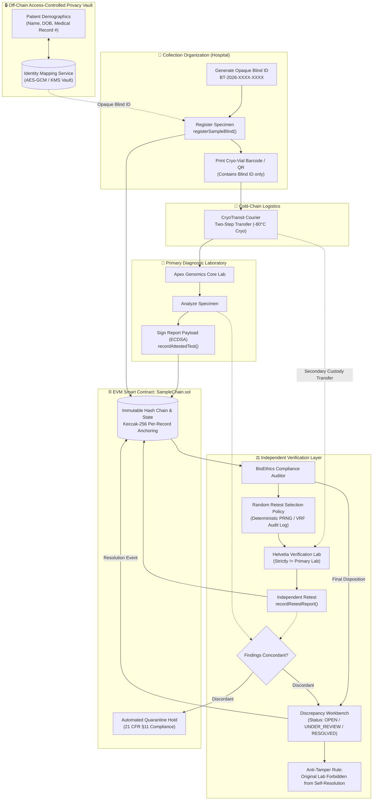

# 🧬 Tracechain 2.0 — Biological Specimen Provenance & Independent Verification

[](https://soliditylang.org/)
[](https://hardhat.org/)
[](https://reactjs.org/)
[](https://vitejs.dev/)
[](https://hardhat.org/)
[](https://www.fda.gov/)
[](LICENSE)

**Tracechain 2.0** is an enterprise-grade decentralized biological specimen custody registry and verification protocol. Engineered for biobanks, clinical research trials, genomics facilities, and hospital pathology networks, Tracechain introduces a **Blind Testing & Independent Verification Layer** that couples cryptographic hash-chain custody with role-separated privacy, digital laboratory report attestations, and anti-collusion secondary verification.

---

## 🎯 The Problem: Why Blockchain Alone Does Not Guarantee Medical Truth

A distributed ledger guarantees **data immutability** and **tamper-evident ordering**: once a record is written, it cannot be secretly altered or deleted. 

However, in laboratory diagnostics and clinical biobanking, **blockchain alone cannot establish physical or medical ground truth**:
- An authorized laboratory employee can inadvertently test the wrong vial, make a pipetting error, miscalibrate a sequencer, or enter a fraudulent result.
- If a corrupt or mistaken entry is anchored on-chain, the blockchain preserves the inaccurate result just as permanently and immutably as a correct one (*"Garbage in, permanent garbage on-chain"*).
- Traditional laboratory systems expose patient demographic identities directly to technicians, creating cognitive bias, selective retesting, or intentional data falsification.

### The Tracechain 2.0 Solution
Tracechain 2.0 designs the system around **multi-layered independent verification, authenticated digital identities, de-identified physical sample handling, and anti-tamper investigation workflows**:
1. **Blind Sample Identification**: Patients' Protected Health Information (PHI) is uncoupled from specimen test requests. Laboratories process specimens identified only by opaque, random Blind Testing IDs (`BT-YYYY-XXXX-XXXX`).
2. **Cryptographically Attested Laboratory Reports**: Diagnostic findings are sealed with structured payloads signed by an authorized laboratory wallet using ECDSA digital signatures.
3. **Independent Retesting Workflow**: Compliance auditors randomly route completed specimens to independent secondary laboratories ($\text{Lab}_2 \neq \text{Lab}_1$).
4. **Discrepancy Investigation Workbench**: Discordant findings trigger an immutable discrepancy case with strict anti-tamper rules—**the original testing laboratory is cryptographically barred from self-resolving disputes against its own findings**.

---

## 🏛️ System Architecture



---

## 🧩 Four Core Pillars of Tracechain 2.0

### 1. Blind Sample Identification & Off-Chain Privacy Boundary
- **Opaque Identifiers**: Specimens are assigned a cryptographically random, collision-resistant Blind Testing ID (e.g., `BT-2026-64589-3281`). Blind IDs do not encode names, phone numbers, birth dates, or national identity numbers.
- **Physical Label Integration**: Cryo-vial barcodes and 2D DataMatrix/QR codes display only the Blind ID, specimen category, and required clinical assay parameters.
- **Strict Separation of Storage**: 
  > [!IMPORTANT]
  > **Solidity `private` variables are NOT confidential.** All state on a public blockchain is readable by anyone querying RPC nodes.
  > Therefore, Tracechain 2.0 strictly forbids publishing patient demographic names or mapping dictionaries to the blockchain. All patient identity data is held in an off-chain access-controlled service abstraction (`identityMappingService.js`).
- **Role-Gated Unmasking**: Only authorized collection personnel (the registering hospital) can decrypt and resolve a specimen's clinical identity. Laboratory personnel only ever see the Blind ID.
- **Production Architecture Note**: The included prototype uses a client-isolated key-value store with role-cleared session authentication for demonstration. For production deployment, this layer must be backed by an audited, HIPAA/GDPR-compliant microservice using enterprise KMS (e.g., AWS KMS, HashiCorp Vault) and hardware security modules (HSM) with mutual TLS and OAuth2/OIDC claims.

### 2. Cryptographically Attested Laboratory Reports
Standard diagnostic logging merely stores an unauthenticated hash. Tracechain 2.0 introduces **digital laboratory attestations**:
- **Structured Payload**: The diagnostic report is bound into an EIP-191 compliant payload:
  $$\text{Payload} = \text{keccak256}(\text{sampleId}, \text{labAddress}, \text{keccak256}(\text{testType}), \text{reportHash}, \text{keccak256}(\text{findingsSummary}), \text{version}, \text{timestamp})$$
- **Cryptographic Signature**: The authorized laboratory wallet signs this payload using ECDSA.
- **On-Chain Signer Recovery**: The smart contract executes EVM ECDSA recovery (`ecrecover`) to verify that the signer is registered with `OrgType.Laboratory` and matches the designated reporter.
- **Immutable Supersession & Versioning**: If an assay requires correction, the laboratory submits an incremented `version` with a reference to the previous report. The original report hash and signature remain permanently in the historical ledger.
- **Security Limitation Disclaimer**:
  > [!WARNING]
  > A valid ECDSA digital signature proves that a specific laboratory private key endorsed a specific report payload; **it does not prove that the laboratory physically calibrated its instruments or measured the specimen correctly**.

### 3. Independent Retesting Workflow
To detect analytical errors or intentional falsification, compliance auditors can order secondary independent testing:
- **Auditor Role Requirement**: Only wallets registered as `OrgType.Auditor` can trigger secondary verification requests (`requestIndependentRetest`).
- **Anti-Collusion Constraint**: The smart contract programmatically enforces that the designated secondary laboratory cannot be the original testing laboratory:
  ```solidity
  if (_retestLab == orig.lab) revert SecondLabMustDiffer();
  ```
- **Audited Random Selection Policy**: The frontend and service layer provide a documented, auditable selection tool. It logs the eligible sample universe, sampling threshold ($10\% - 25\%$), RNG method, initiator identity, and timestamp.
  *(Prototype note: client-side selection uses deterministic PRNG seeded with timestamp and block hash. Production deployments should feed verifiable randomness via Chainlink VRF or threshold beacon committees).*
- **Custody Transfer to Verification Lab**: The specimen is transferred to the second laboratory using the two-step custody handoff protocol. The second lab inspects vial seals and custody telemetry before accepting.
- **Dual Attestation Binding**: The secondary lab records its own attested report (`recordRetestReport`), cryptographically linked to the original request without overwriting the primary report.

### 4. Discrepancy Detection & Investigation Workbench
When primary and secondary laboratory findings differ materially (e.g., primary reported *EGFR Wild-Type* while retest confirmed *EGFR T790M Drug-Resistant Mutation*):
- **Automatic Discrepancy Flagging**: A `DiscrepancyCase` is instantiated on-chain with state `OPEN` (0), immediately triggering a quarantine hold (`Status.Quarantined`) on the specimen.
- **Strict Anti-Tamper Protection**:
  ```solidity
  // contracts/SampleChain.sol
  if (msg.sender == c.originalLab) revert SelfResolutionForbidden();
  ```
  The original testing laboratory is **completely barred** from resolving, dismissing, editing, or closing discrepancy cases against its own findings.
- **Adjudication Dispositions**: Independent auditors review BAM alignment files, chromatograms, and custody evidence before issuing a binding disposition:
  - `AFFIRMED_ORIGINAL` (Primary findings confirmed valid)
  - `AFFIRMED_RETEST` (Secondary verification confirmed valid; primary overturned)
  - `INCONCLUSIVE` (Specimen degradation / analytical indeterminate)
  - `FALSE_POSITIVE_PRIMARY` (Primary lab issued false positive)
  - `FALSE_NEGATIVE_PRIMARY` (Primary lab failed to detect target analyte)
- **Quarantine Release Integration**: Upon resolution, the auditor can atomically lift the quarantine hold with an auditable justification hash.

---

## 🔬 Smart Contract Specification (`SampleChain.sol`)

### New Record Types (Indices 16–20)
| Type Index | Enum Identifier | Description |
|:---:|:---|:---|
| **16** | `ReportAttested` | ECDSA-signed diagnostic report submitted by primary laboratory |
| **17** | `RetestRequested` | Independent secondary verification ordered by compliance auditor |
| **18** | `RetestReported` | Digitally attested secondary test recorded by independent lab |
| **19** | `DiscrepancyFlagged` | Material analytical discordance identified and sample quarantined |
| **20** | `DiscrepancyResolved` | Auditor records formal disposition and adjudication justification |

### New Core Methods
```solidity
// Register specimen with opaque blind testing ID
function registerSampleBlind(NewSample calldata p, string calldata _blindId) external returns (bytes32 sampleId);

// Record primary digitally attested laboratory report
function recordAttestedTest(
    bytes32 _sampleId,
    string calldata _testType,
    bytes32 _reportHash,
    string calldata _findings,
    uint256 _version,
    bytes calldata _signature
) external returns (bytes32 reportId);

// Order independent retest with a distinct laboratory
function requestIndependentRetest(
    bytes32 _sampleId,
    bytes32 _originalReportId,
    address _retestLab,
    string calldata _retestType,
    string calldata _reason
) external returns (bytes32 requestId);

// Record independent retest report by secondary lab
function recordRetestReport(
    bytes32 _requestId,
    bytes32 _reportHash,
    string calldata _findings,
    bytes calldata _signature
) external returns (bytes32 reportId);

// Flag discrepancy and place sample under quarantine hold
function flagDiscrepancy(
    bytes32 _sampleId,
    bytes32 _requestId,
    string calldata _reason,
    bytes32 _evidenceHash
) external returns (bytes32 caseId);

// Adjudicate discrepancy with anti-tamper enforcement (Original lab cannot call)
function resolveDiscrepancy(
    bytes32 _caseId,
    DiscrepancyDisposition _disposition,
    string calldata _resolutionReason,
    bool _releaseQuarantine
) external;
```

---

## 🧪 Automated Test Suite (27 Passing Tests)

Tracechain 2.0 includes 27 comprehensive tests covering the complete biobank lifecycle, cold-chain handoffs, blind testing, cryptographic attestations, retesting workflows, and anti-tamper security guarantees.

```bash
npx hardhat test
```

### Test Suite Execution Output
```
  SampleChain - Biological Specimen Chain of Custody
    Governance & Organization Onboarding
      √ should set deployer as admin
      √ should allow admin to register new organization
      √ should revert if non-admin tries to register org
      √ should prevent duplicate organization registration
      √ should toggle org active status
      √ should handle emergency pause and unpause
    Sample Lifecycle & Hash Chain Provenance
      √ should register sample with verified initial hash chain
      √ should log cryogenic storage with temperature
      √ should split into an aliquot (child sample)
      √ should record diagnostic test with report hash
    Custody Handoffs & Quarantine Behavior
      √ should complete two-step transfer when recipient accepts intact
      √ should AUTOMATICALLY QUARANTINE sample if recipient marks damaged on arrival
      √ should allow auditor to release quarantined sample
      √ should allow batch custody transfer
      √ should provide system statistics and paginated queries
    Blind Testing & Independent Verification Layer
      √ should store opaque blind identifier without exposing patient PII
      √ should submit cryptographically attested report with valid ECDSA signature
      √ should reject report if signature does not match lab wallet
      √ should reject report submission from unauthorized non-lab account
      √ should support report versioning/supersession without deleting previous report
      √ should allow auditor to request independent retest with a different laboratory
      √ should REVERT if auditor tries to assign the original testing lab as the retest lab
      √ should REVERT if unauthorized user tries to request an independent retest
      √ should allow second lab to complete retest after receiving sample in custody
      √ should flag a discrepancy and place sample in quarantine hold
      √ should FORBID original lab from resolving its own discrepancy
      √ should allow auditor to resolve discrepancy with formal disposition and quarantine release

  27 passing (1s)
```

---

## 💻 DApp Interfaces & User Workflows

The frontend is built with **React 18, Vite, and Tailwind CSS** adhering to a high-contrast **Neo-Brutalist design language** (tactile 2px black borders, crisp drop-shadows, animated scanlines, and high-readability typography).

### 1. Unified Navigation & Role Switcher
- **Live Role Switcher**: Instant switching between 6 pre-configured organizational identities:
  1. `Memorial Sloan Bio-Center` (Hospital / Collection)
  2. `Apex Genomics Core Lab` (Primary Testing Lab)
  3. `Helvetia Independent Verification Laboratory` (Secondary Verification Lab)
  4. `Cambridge BioDiscovery Institute` (Research Facility)
  5. `CryoTransit Cold-Chain Logistics` (Courier)
  6. `BioEthics & Regulatory Compliance Auditor` (Auditor)
- **Discrepancy Counter Badge**: Real-time counter on the **Workbench** navbar tab alerting operators to open discrepancy cases requiring review.

### 2. Discrepancy Investigation Workbench (`DiscrepancyWorkbench.jsx`)
- **Side-by-Side Analytical Diff**: Compares primary laboratory findings against independent verification retest findings.
- **Cryptographic Signature Inspector**: 1-click verification of ECDSA signatures against registered laboratory public keys.
- **Anti-Tamper Lockout Guard**: If the logged-in user is the original testing laboratory, the resolution panel is disabled with an explicit warning banner: *"Anti-Tamper Lockout: You are logged in as the original testing laboratory. Self-resolution of disputes is forbidden by contract rules."*
- **Random Sample Selection Policy Modal**: Allows auditors to simulate and audit random sampling across all completed tests with documented audit logs.

### 3. Lab & Audit Compliance Portal (`AuditCompliance.jsx`)
- **Attested Report Submission**: Structured report upload modal that calculates Keccak-256 hashes, generates ECDSA signatures, and commits attested records to the EVM hash-chain.
- **Retest Request Dispatcher**: Dedicated portal for compliance auditors to assign specimens to independent verification facilities.
- **Report Integrity Verification Tool**: Verifies whether an off-chain report file matches its recorded on-chain hash and cryptographic signature.

### 4. Barcode & Cryo-Vial Label Generator (`BarcodeModal.jsx`)
- Generates compliant cryogenic vial labels containing the **Blind Testing ID**, sample type, collection timestamp, and a scannable QR code carrying de-identified custody metadata.

---

## 🛠️ Installation & Getting Started

### Prerequisites
- **Node.js**: v18.0.0 or higher
- **npm**: v9.0.0 or higher

### 1. Clone & Install
```bash
git clone https://github.com/Rajarshisaha10/Tracechain.git
cd Tracechain
npm install
```

### 2. Run Smart Contract Tests
```bash
npm run test:contracts
```

### 3. Build Production Bundle
```bash
npm run build
```

### 4. Launch Local Development Server
```bash
npm run dev
```
Open **[http://localhost:5173](http://localhost:5173)** in your browser.

---

## 🌐 Blockchain Network Deployment

### Deploy to Local Hardhat Node
```bash
# Terminal 1: Start local node
npx hardhat node

# Terminal 2: Deploy and seed contracts
npm run deploy:local
```

### Deploy to Ethereum Sepolia Testnet
1. Configure `.env`:
```env
SEPOLIA_RPC_URL="https://sepolia.infura.io/v3/YOUR_INFURA_PROJECT_ID"
PRIVATE_KEY="0xYOUR_TESTNET_PRIVATE_KEY"
ETHERSCAN_API_KEY="YOUR_ETHERSCAN_API_KEY"
```
2. Run deployment script:
```bash
npx hardhat run scripts/deploy.js --network sepolia
```

---

## 📋 Security Assumptions & Operational Boundaries

| Domain | Prototype Implementation | Production Requirement |
|:---|:---|:---|
| **Patient Identity Storage** | In-browser isolated service abstraction (`identityMappingService.js`) | Off-chain HIPAA/GDPR compliant KMS vault, encrypted database, role-based OAuth2/OIDC. |
| **Laboratory Key Management** | Browser-signed ECDSA private keys | Hardware Security Modules (HSM), Cloud KMS (AWS KMS / Google Cloud HSM), or multi-sig lab wallets. |
| **Random Retest Selection** | Deterministic pseudo-random selection with client auditable log | Verifiable Random Function (e.g. Chainlink VRF) or multi-party commit-reveal beacon. |
| **Physical Specimen Integrity** | Barcode / QR label with two-step digital handoff certification | Tamper-evident tamper-destruct RFID cryo-seals and automated IoT cryogenic temperature loggers. |
| **Medical Diagnostics Ground Truth** | Cryptographic proof of signature & multi-lab concordance | Independent dual-laboratory blind testing, proficiency testing, and blind controls. |

---

## 📜 Regulatory Standards Alignment
- **21 CFR Part 11**: Electronic Records, Electronic Signatures, Immutable Audit Trails, and Non-Repudiation.
- **ISO 20387:2018**: Biotechnology — Biobanking — General requirements for biobanking quality management.
- **HIPAA Privacy Rule / GDPR Art. 9**: Processing of special categories of personal data via strict off-chain de-identification and cryptographic pseudonymization.

---

## 📄 License
This project is open-source under the [MIT License](LICENSE).
